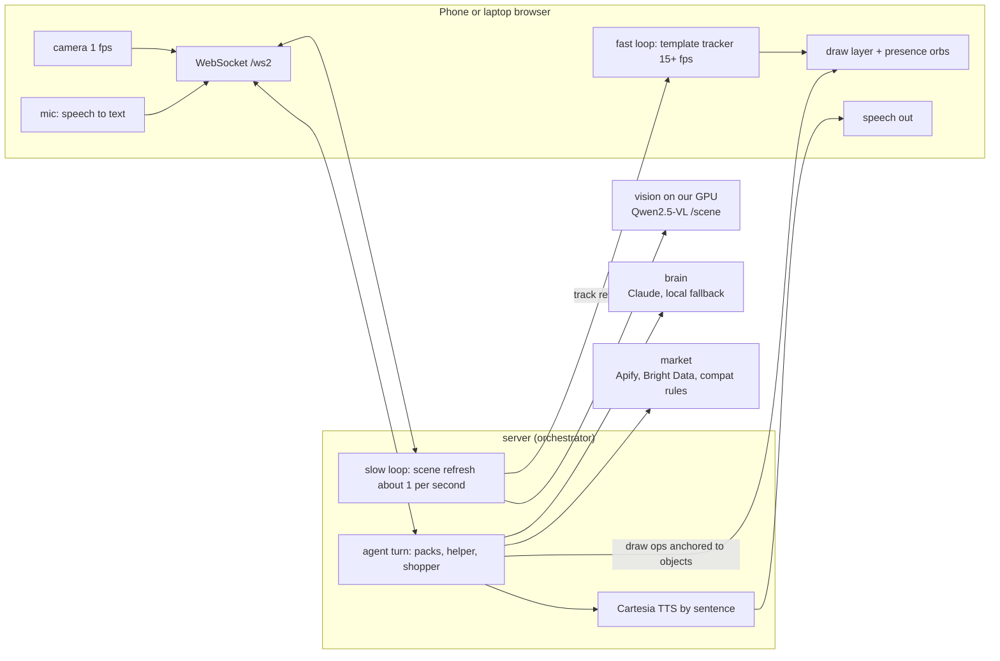

# A-eye

**A video call with an AI that can see, point, draw and talk back.** Pronounced like "AI", spelled with an eye,
because it sees.

Point your phone at whatever you are working on and talk. A-eye looks at the live picture, answers out loud, and
draws right on the video: a box around the part you need, an arrow to where it goes, a circle where to cut, a label,
a pin. The drawings stay stuck to things as the camera moves. A small glowing presence shows when it is listening,
thinking or speaking, and drifts toward what it points at. Ask "is there a cheaper one?" and a second agent, the
shopper, joins the call with prices that fit what you already own.

Status: Cal Hacks 13.0 build in progress. The talk, see and draw loop runs end to end on our own GPU; real-time
tuning and the phone app are in progress.

## What it does

1. **Talks back, in real time.** Speak, interrupt it any time (it stops talking when you do), and it answers in
   short spoken sentences while it is still thinking.
2. **Sees and draws on your world.** Boxes, highlights, circles, arrows, freehand paths, labels and pins, placed on
   real objects the vision model found, and tracked in the browser between updates so they do not lag the camera.
3. **Skill packs.** A general helper, plus packs that know a task: PC building (grounded in your motherboard's own
   manual, with a power-off-first safety gate), cooking and assembling things. A pack sets what the helper knows,
   what it looks for, and what it refuses.
4. **More than one agent.** The helper guides; the shopper checks live prices and only suggests parts that a rules
   engine in code says fit. Each agent has its own name, color and on-screen presence.

## What makes it different

| | Gemini Live | ChatGPT video | A-eye |
|---|---|---|---|
| Talks about what the camera sees | Yes | Yes | Yes |
| Draws on the live picture (arrows, circles, paths, pins) that follow objects | Highlight boxes | No | Yes |
| Task packs with their own knowledge and safety rules | No | No | Yes |
| A second agent that checks prices that fit what you own | No | No | Yes |
| Video processed on our own GPU by default | No | No | Yes |

The comparison reflects our own review of these products during the event; we claim the combination, not a first.

## Safety and privacy, in code

- **Pack safety gates.** The PC pack will not guide anything until you confirm the power is off and unplugged.
  Packs refuse dangerous requests (mains wiring, opening power supplies, gas lines) with a fixed line.
- **No video stored.** Only the newest frame is kept in memory. Nothing is written to disk or logs.
- **Local by default.** Frames go to the vision model on our own GPU. The reasoning model gets a text description
  of the scene, not the picture. `LOCAL_ONLY=1` blocks cloud models entirely.
- **Compatibility is decided by rules.** Unknown specs show as "unverified", never "fits".

## Architecture



Every message is defined once in [`contracts/schema.json`](contracts/schema.json): v2 (`/ws2`) is the agent
call; v1 (`/ws`) is the original PC-build step flow and still works.

Real-time budgets we design for: overlay updates at 15 fps or more, vision refresh within 1 s, first spoken
sound within 1.5 s of your last word, interruption within 200 ms. A dev overlay (`?dev=1`) shows the measured
numbers.

## Repo layout

| Path | What |
|---|---|
| `contracts/` | JSON Schemas (v1 and v2), TypeScript and Python types, examples |
| `server/` | Orchestrator: `/ws2` agent, skill packs, shopper, model router; `/ws` v1 step flow |
| `vision/` | Vision service: `/scene` and v1 endpoints; Qwen2.5-VL on the GPU, fake fallback |
| `voice/` | Cartesia TTS adapter |
| `client-web/` | Browser call page (`/agent.html`), draw layer, presence, voice, tracker |
| `ios/` | Native iPhone app |
| `market/` | Price search and compatibility rules |
| `data/` | Hand-checked header tables per board |
| `eval/` | Accuracy harness |
| `docs/` | Notes, package results |

## Team

| Role | Who | Owns |
|---|---|---|
| A | the team | iPhone app, contracts, integration |
| B | TBD | Vision on the GPU, model router |
| C | TBD | Market search, store |
| D | TBD | Agent, voice, eval, pitch |

## Sponsor tech

Planned, confirmed in this list only once it runs in the demo:
Cartesia (voice), Claude by Anthropic (reasoning), Apify and Bright Data (live prices), Convex (project memory).
Open models on our own GPU: Qwen2.5-VL (vision), Whisper (speech to text, optional).

## Voice: Cartesia

Voice is how you use A-eye: you talk while your hands are on the board, and it talks back while it
draws on the picture. You can cut in at any time and it stops.

**Setup.** Put `CARTESIA_API_KEY` in `.env` (server side only, never sent to the browser) and run
`make server`. Cartesia is then the default voice. `CARTESIA_VOICE_ID` picks a voice; Katie is the
default. Kokoro on the GPU box is the fallback, and `?tts=browser` selects browser speech.

**Cartesia features used** (`voice/cartesia_ws.py`):
- Sonic 3.6 streaming over the TTS WebSocket. One socket per call, opened at hello, so a turn does
  not pay the TLS handshake. PCM s16le at 16 kHz goes straight to the page.
- One `context_id` per turn. A Claude Haiku talker streams its reply clause by clause; each clause is
  pushed into the same context (`continue`, `flush`, `max_buffer_delay_ms: 0`), so prosody flows
  across the reply and speech starts on the first clause.
- Cancel on barge-in. When the user starts talking, the server sends `cancel` for that context and
  the page stops playback.
- The voice library. `/api/voices` offers Katie (friendly), Cathy (coworker) and Parker (supportive
  pal).

**Latency.** Server speech recognition, 6 turns each, synthetic speech, timed from the final audio
chunk (`voice/bench_stt.py`):

| Setup | Transcribed | First audio |
|---|---|---|
| Before: full-clip Whisper, Kokoro | 838 ms | 2062 ms |
| Partial Whisper while speaking, Kokoro | 41 ms | 1117 ms |
| Partial Whisper while speaking, Cartesia Katie | 37 ms | **1008 ms** |

One Cartesia clause takes 118 ms warm and 284 ms cold. More detail is in
[docs/voice-options.md](docs/voice-options.md).

**Known limitations.**
- Measured with synthetic speech, not a person in the hall.
- Turn-taking is not truly full duplex: barge-in comes from voice activity detection, not from the
  model.
- If Cartesia fails mid-clause after audio has started, the rest of that clause is lost. Kokoro
  takes over only when Cartesia fails before any audio.
- In a loud room, hold to talk (button or Space) is more reliable than hands-free.

## Rewind: TwelveLabs

Rewind is optional and off by default. A-eye keeps short clips around scene changes and indexes them with
TwelveLabs Marengo, so you can ask "when did I plug in the CPU fan?" and get the moment with the part boxed.
Our own vision model double-checks each hit, and clips are uploaded only while the Rewind switch is on
(Settings, Rewind). Results: [docs/results/rewind.md](docs/results/rewind.md).

## Run it

Needs Python 3.11+, [uv](https://github.com/astral-sh/uv), and Node 20+ for the web tests.

```sh
make setup             # .venv + Python deps
cp .env.example .env   # fill keys locally; .env is gitignored
make keys              # shows which keys are set (length only)
make test              # all module tests
make vision            # vision service on :8001 (VISION_BACKEND=fake|ollama|auto)
make server            # orchestrator on :8000; open http://localhost:8000/agent.html
make smoke             # v1 end to end with the fake vision model
make phone             # prints the HTTPS command for testing on an iPhone
```

Safari needs HTTPS for the camera and mic on a phone; `make phone` prints the Tailscale command to run.

See [AGENTS.md](AGENTS.md) for team rules and [CONTRIBUTING.md](CONTRIBUTING.md) for the PR flow.

## Public source export

Use [the checked export workflow](docs/public-export.md) to create a fresh public snapshot without private history.
