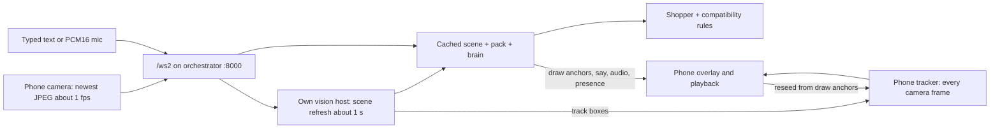

# A-eye phone API reference

Use `/ws2` for the SwiftUI call. All socket messages are JSON text messages. The wire version is `v: 2`; v2.0, v2.1 and v2.2 are additive revisions, not different wire integers. Ignore unknown response fields, message types and draw kinds. Send only defined request fields: the current server validates requests strictly. [Schema](../contracts/schema.json) is authoritative; [examples](../contracts/examples.json), [types](../contracts/types.ts) and [changelog](../contracts/CHANGELOG.md) accompany it. `/ws` remains the separate v1 PC step protocol; do not send v2 messages there.

Items marked **(new tonight)** are the parallel package's supplied specification, not verified implementations in this checkout. Token enforcement, REST adapters, mock mode and the expanded phone target need that package integrated first.

## Architecture and the two loops



The slow loop grounds objects about once per second (default scene interval 1000 ms, subject to inference and GPU contention). Draw operations use those objects when a user turn runs; they are **not** emitted automatically every second. Scene refresh sends `track` then frame `metrics`. Optional detector refresh may add more `track` messages; its schema describes 10 to 15 fps when available, not a delivery guarantee.

The phone owns the fast loop: for example, run Vision `VNTrackObjectRequest` between server updates. Reseed each object from `draw.ops[].anchor` and each newer `track.objects[]` entry, matched by object ID. Retain the sent frame's geometry/sequence so an old result cannot replace a newer anchor. Track each object independently; a missing object in a partial track update is not a deletion. Clear local trackers on session reset or tracking loss. Never persist raw camera or mic data.

## Origins, transport and authentication

| Use | HTTP origin | Socket |
|---|---|---|
| Mac simulator/local development | `http://127.0.0.1:8000` | `ws://127.0.0.1:8000/ws2` |
| Phone on LAN | `http://<mac-lan-ip>:8000` | `ws://<mac-lan-ip>:8000/ws2` |
| Tailscale HTTPS | `https://<mac>.<tailnet>.ts.net` | `wss://<mac>.<tailnet>.ts.net/ws2` |
| Quick tunnel HTTPS | `https://<assigned-host>.trycloudflare.com` | `wss://<assigned-host>.trycloudflare.com/ws2` |

On a physical phone, localhost is the phone, not the Mac. Prefer HTTPS/WSS with a trusted certificate; native development over HTTP may need a narrowly scoped app transport exception. Browser camera/mic access on a phone needs HTTPS.

First set `A_EYE_TOKEN` to a long random secret on the server and restart it, or configure both `CF_ACCESS_TEAM_DOMAIN` and `CF_ACCESS_AUD` with working Access sign-in. Do not start a tunnel without credentials. `make phone` prints this prerequisite first and refuses to suggest tunnel commands without credentials, even with `A_EYE_OPEN=1`. Once configured, it prints `tailscale serve --bg 8000` (same tailnet only) and `cloudflared tunnel --url http://localhost:8000` (public), using `SERVER_PORT` when overridden. It does not start the tunnel or change network settings.

**(new tonight)** With server env `A_EYE_TOKEN` set, `/ws2` and `/ws` require `?token=<secret>` or `Authorization: Bearer <secret>` in the upgrade request. Prefer the header in Swift; do not log it. Missing/bad credentials close with **4401**. All `/api/*` routes require authentication too: use the bearer header; unauthorized requests return HTTP **401** with `{"error":"unauthorized"}`. With all auth env vars unset, only direct loopback peers without proxy headers are allowed unless `A_EYE_OPEN=1` explicitly opens access. The presence of `CF-Connecting-IP`, `X-Forwarded-For`, `Forwarded`, `X-Real-IP`, `Tailscale-User-Login`, `Tailscale-User-Name`, or `CF-Ray` removes local trust, regardless of value. Header values never grant access. `/health` is public and returns `{"ok":true}`. These HTTP bodies are not the vision service's `health_response` contract.

Pairing limits use `CF-Connecting-IP`, then the first `X-Forwarded-For` hop, only for a loopback proxy peer; otherwise they use the TCP peer. `make server` and `make mock` pass `--no-proxy-headers` to Uvicorn so that the app receives that TCP peer unchanged. Use the same flag in custom launches. A configured server also accepts `/ws2?pair=<code>&join=<secret>` without the master token, but only for a matching camera hello: the secret is single-use and cannot authorize API calls or a normal call socket.

### Cloudflare Access

For `https://<YOUR_DOMAIN>`, configure email one-time PIN and an email allowlist in Access, then set `CF_ACCESS_TEAM_DOMAIN` and `CF_ACCESS_AUD` on the server. The shared API and socket check verifies RS256 signatures, issuer, audience and expiry using the team's cached signing keys. The Access header or `CF_Authorization` cookie authenticates same-origin requests and WebSocket upgrades; no `?token` is needed. A paired phone signs in separately. A 4401 close offers “Please sign in again” and a reload instead of automatic retries.

`A_EYE_TOKEN`, if configured, remains an alternative credential. Open mode applies only when all three auth settings are empty; incomplete Access settings fail closed. `/health` remains public.

## Session lifecycle

1. Connect, then send `hello` with a nonempty `session_id` and pack (`general`, `pc_build`, `cooking`, `assemble`). Optional board defaults to `demo-b650`; `tts` and `stt` default to `browser`. On iOS, `browser` means client-managed speech: speak `say.text` or send final transcripts as `user_text`.
2. Wait for helper `agent_state: listening`. There is no separate hello-ack message. Every later request must carry the same session ID.
3. Send upright JPEGs about 1 fps, long side at most 640 pixels, quality 0.7. Send actual encoded pixel `w`/`h`, Unix epoch milliseconds in `ts_ms`, increasing nonnegative `seq`. Keep only the newest captured frame; drop frames while sending. The server replaces its in-memory frame only for a larger sequence. V2 has no orientation field: rotate pixels before encoding.
4. Talk with `user_text` (`final:false` interim; `final:true` starts the turn), or choose `stt:server` and send `audio_in`, ending the utterance with `final:true`. Audio input is ignored when server STT is not selected. A new final request cancels the prior turn and audio.
5. On interruption, stop playback and queued audio locally immediately, then send `barge_in` with the interrupted utterance ID and elapsed playback `at_ms`. The current server cancels the active turn and all its audio, then sends listening. Ignore late chunks for cancelled utterances. Interim speech can also cancel the active turn.
6. For `pc_build`, offer an explicit power-off/unplugged confirmation and send `confirm` with `what:power_off,value:true` only after the user confirms. This resets on every hello. Other `what` values are valid contract members but currently do not cause `/ws2` actions. `confirm:stop` is not a socket close.
7. Close normally (1000) when leaving the call. Stop capture/playback and clear overlays. Disconnect destroys server scene, frame and history; there is no durable resume or replay.

Reconnect on transport failure with exponential backoff (for example 1, 2, 4, 8, 16, capped at 30 seconds, plus jitter). Resend hello and clear local state. A **new hello on the same socket also resets the session**, including safety confirmation. Do not replay old frames, mic chunks or user requests. For 4401, stop automatic retries until credentials are corrected. A clean intentional close must not reconnect.

## Message catalog

Names beginning `v2_` below are schema names; the wire `type` omits that prefix. Every message includes required `v` and `type`. Client messages also require `session_id`. Optional properties are marked `?`. Full examples below are copied from `contracts/examples.json`, including their placeholder image/audio strings; those strings validate structurally but are not usable camera/audio fixtures.

| Direction | Type | Fields beyond envelope | Behavior |
|---|---|---|---|
| Phone → server | `hello` | `pack`, `board_id?`, `client?`, `tts?`, `stt?` | Start/reset session; choose pack and speech modes. |
| Phone → server | `frame` | `seq`, `ts_ms`, `w`, `h`, `jpeg_b64` | Replace newest frame; not a turn trigger. |
| Phone → server | `user_text` | `text`, `final`, `source?` | Final transcript/typed text starts a turn. |
| Phone → server | `barge_in` | `utterance_id`, `at_ms` | Cancel current turn and speech. |
| Phone → server | `confirm` | `what`, `value` | Power-off gate; other values currently ignored. |
| Phone → server | `audio_in` | `seq`, `sample_rate?`, `pcm16_b64`, `final?` | Mic chunks; server STT only. |
| Server → phone | `draw` | `agent`, `seq`, `ops` | Apply ordered ops on the agent layer. |
| Server → phone | `say` | `agent`, `utterance_id`, `text`, `turn_id?`, `part?`, `final?` | Caption/speech part; group by turn and utterance. |
| Server → phone | `agent_state` | `agent`, `state`, `focus?` | Presence per helper/shopper. |
| Server → phone | `audio` | `agent`, `utterance_id`, `sample_rate?`, `pcm16_b64`, `final?` | PCM output keyed by utterance ID. |
| Server → phone | `metrics` | `turn_id?`, `seq?`, `vlm_ms?`, `brain_first_token_ms?`, `first_audio_ms?`, `turn_ms?`, `track_ms?` | Optional timings in milliseconds; absent is unknown. |
| Server → phone | `track` | `seq`, `objects` | Fresh object boxes for reseeding. |
| Server → phone | `market_results` | `agent`, `result` | Shopper offers; nested result stays v1. |
| Server → phone | `error` | `code`, `message` | Recoverable message unless transport also closes. |

`user_text.source` is `typed`, `browser_stt` or `whisper`; there is no `ios_stt` value. `confirm.what` is `power_off`, `seated`, `check_again`, `next` or `stop`. Agent IDs are `helper` and `shopper`. `metrics` may describe a turn (`turn_id`) or frame (`seq`); `vlm_ms` on a turn is time waiting for a scene, not necessarily the full background inference duration. `brain_first_token_ms` measures from brain start, `first_audio_ms` and `turn_ms` from turn start; `track_ms` is optional. Server STT turns start their timer at receipt of the final input chunk. These are server timings, not guaranteed phone end-of-speech-to-speaker measurements.

### Turn ordering and presence

For a successful normal turn: helper `thinking` → `draw` → selected agent `speaking` (optional `focus`) → streamed `say` parts → end-of-turn `metrics`. `focus` is the center of the first resolved target when available. Audio for each part follows its `say`, but audio and later `say` messages can interleave. A single worker preserves speech-part playback order; metrics follow completion of that worker. Parts share `turn_id`, increase `part` from zero, and use separate `utterance_id`s. Buffer/append captions by part rather than replacing the entire answer.

`final:true` on `say` denotes the final part; on `audio` it denotes the final chunk for that utterance. They are different boundaries. **Current implementation caveat:** the early-clause path can emit all text with `final:false` and omit a final say marker. Do not wait forever for that marker; turn metrics are the normal successful completion signal. Cancellation/errors may omit metrics too. Safety refusals and power-off prompts can be standalone say messages with none of the streaming fields and no draw/metrics.

Shopping adds shopper `thinking`, a shopper say announcing the search, `market_results` on success, shopper `speaking`, then a final shopper say. These parts share the turn and can interleave with earlier audio. Market failure can omit results and still produce an explanation. Background `track` and frame metrics can appear anywhere. There is no global transaction grouping beyond the fields present on each message; draw and presence have no turn ID.

Presence values: `idle` = inactive; `listening` = ready for user; `thinking` = processing; `speaking` = producing a response. Keep helper and shopper presence separate. No post-turn idle/listening transition is guaranteed by this implementation. Drive actual mouth/playback activity from local audio completion too.

### Coordinates, tracking and rendering

All coordinates are normalized 0..1 in the **sent frame**, origin at top left, x rightward and y downward. A bbox is `[x,y,w,h]`, not corners. Apply aspect-fit/ aspect-fill offsets and cropping when mapping to the preview; match mirroring to the uploaded pixels. Vision uses bottom-left normalized rectangles: convert with `visionY = 1 - y - h`, and reverse that conversion on tracker output.

Use `(agent, op.id)` as overlay identity. Process ops in order. Preserve original geometry and anchor; transform it from the anchor's original bbox into the tracked bbox (translation and relative scale). Reseed rather than repeatedly compounding transforms. Hide stale/lost tracked overlays rather than inventing a target. Neither confidence nor latency is guaranteed by receiving a draw.

| Kind | Geometry | Render |
|---|---|---|
| `box` | `bbox` | Outline rectangle; optional label |
| `highlight` | `bbox` | Translucent fill over rectangle |
| `circle` | `center`, `r` | Circle around target; browser convention scales r by the shorter source-frame dimension, then the preview scale |
| `arrow` | `from`, `to` | Line with arrowhead at `to` |
| `path` | `points` (at least 2) | Ordered polyline; close only if endpoints repeat |
| `label` | `at`, nonempty `text` | Text at normalized location |
| `pin` | `at` | Point marker |
| `clear` | no geometry | Clear that agent's overlay layer; ID is not a selective-delete instruction |

All kinds require `id`; optional common fields are `role`, `label`, `ttl_ms`, `anchor`. Roles are `target`, `info`, `warn`, `ok`; choose accessible colors/styles and do not rely on color alone. A missing/zero TTL persists until clear; positive TTL expires after that many milliseconds. Anchor is `{object_id,bbox}`. Circle radius convention is a renderer choice, not further specified by the schema.

### Audio and size limits

Both directions use base64 of raw **16 kHz mono signed PCM16 little-endian**, without WAV headers. Optional `sample_rate`, when supplied, must be 16000. Resample mic input before sending. Use even byte counts; a useful input chunk is 100 ms = 3200 bytes, but no fixed chunk length is required. End one utterance with `final:true` (an empty final chunk is allowed). Server buffers up to **1,920,000 decoded bytes = 60 seconds** per utterance, rejects odd byte lengths or invalid base64 as `bad_message`, and clears the buffer on rejection.

Output chunk lengths vary: current Kokoro adapter requests 2048-byte chunks (64 ms), Cartesia 4096 bytes (128 ms); the final chunk may be shorter or empty. Do not assume these lengths are contractual. Decode, queue by utterance and stream to an audio engine; do not play base64 or use one audio player per chunk. In `tts:browser`, speak say text locally; in `tts:server`, play audio and use say only for captions. Current non-mock server may supply no audio if its voice adapter is unavailable; the client must handle that state.

The schema has no JPEG byte cap, socket message-size cap, max text length or maximum frame dimensions; 640/0.7 is the phone transport recommendation, not enforced by this schema. Transport/proxy limits may still apply. Do not infer an unlimited accepted payload. Scene requests allow at most 8 nonempty queries and `max_objects` 1 to 20. Market `max_results` bounds are listed in the REST fields below. V2 does not implement the v1 1.5-second stale-frame rejection; freshness and seq handling on the phone matter.

### Errors and phone action

| Code | Phone action |
|---|---|
| `bad_message` | Check schema, matching session, pack/board, audio encoding/size; correct before retrying. |
| `power_off_required` | Show power-off/unplug prompt; require explicit confirmation. |
| `refused` | Show refusal; do not automatically retry the same unsafe request. |
| `vision_unavailable` | Show degraded vision, hide unreliable overlays; continue text; retry a fresh frame later. |
| `brain_unavailable` | Show degraded/fallback response and allow manual retry. |
| `internal` | Show failure, allow retry; for server-speech failure switch to local transcription/user_text. |
| socket close `4401` **(new tonight)** | Stop reconnect loop, correct credentials, reconnect with hello. |

These are all schema-defined v2 error codes. Some are reserved/not emitted by the current normal path: pack safety failures currently return fixed `say` text, not necessarily `refused` or `power_off_required`. Server STT failure currently emits `internal` and switches to browser mode for that session; it sends no transcript message. Never parse arbitrary error wording as a stable machine code. Other network/abnormal closures use the reconnect policy above; no other application-specific close code is specified here.

## Full WebSocket examples

### hello (variant 1)

<!-- contract: v2_hello -->
```json
{
  "v": 2,
  "type": "hello",
  "session_id": "s2",
  "pack": "general",
  "client": "web",
  "tts": "browser"
}
```

### hello (variant 2)

<!-- contract: v2_hello -->
```json
{
  "v": 2,
  "type": "hello",
  "session_id": "s3",
  "pack": "general",
  "tts": "server",
  "stt": "server"
}
```

### frame

<!-- contract: v2_frame -->
```json
{
  "v": 2,
  "type": "frame",
  "session_id": "s2",
  "seq": 7,
  "ts_ms": 1761271200123,
  "w": 640,
  "h": 480,
  "jpeg_b64": "/9j/4AAQ"
}
```

### user_text

<!-- contract: v2_user_text -->
```json
{
  "v": 2,
  "type": "user_text",
  "session_id": "s2",
  "text": "where does this go",
  "final": true,
  "source": "browser_stt"
}
```

### barge_in

<!-- contract: v2_barge_in -->
```json
{
  "v": 2,
  "type": "barge_in",
  "session_id": "s2",
  "utterance_id": "u3",
  "at_ms": 420
}
```

### confirm

<!-- contract: v2_confirm -->
```json
{
  "v": 2,
  "type": "confirm",
  "session_id": "s2",
  "what": "power_off",
  "value": true
}
```

### audio_in

<!-- contract: v2_audio_in -->
```json
{
  "v": 2,
  "type": "audio_in",
  "session_id": "s2",
  "seq": 3,
  "sample_rate": 16000,
  "pcm16_b64": "AAAA",
  "final": true
}
```

### draw

<!-- contract: v2_draw -->
```json
{
  "v": 2,
  "type": "draw",
  "agent": "helper",
  "seq": 7,
  "ops": [
    {
      "kind": "clear",
      "id": "c0"
    },
    {
      "kind": "box",
      "id": "o1",
      "bbox": [
        0.4,
        0.55,
        0.06,
        0.03
      ],
      "role": "target",
      "label": "CPU_FAN",
      "anchor": {
        "object_id": "o1",
        "bbox": [
          0.4,
          0.55,
          0.06,
          0.03
        ]
      }
    },
    {
      "kind": "arrow",
      "id": "a1",
      "from": [
        0.2,
        0.9
      ],
      "to": [
        0.43,
        0.56
      ],
      "role": "target"
    },
    {
      "kind": "circle",
      "id": "c1",
      "center": [
        0.5,
        0.5
      ],
      "r": 0.05,
      "role": "info"
    },
    {
      "kind": "path",
      "id": "p1",
      "points": [
        [
          0.1,
          0.1
        ],
        [
          0.2,
          0.15
        ],
        [
          0.3,
          0.1
        ]
      ],
      "role": "info"
    },
    {
      "kind": "label",
      "id": "l1",
      "at": [
        0.5,
        0.2
      ],
      "text": "stir here",
      "ttl_ms": 4000
    },
    {
      "kind": "pin",
      "id": "pn1",
      "at": [
        0.6,
        0.6
      ],
      "role": "warn"
    },
    {
      "kind": "highlight",
      "id": "h1",
      "bbox": [
        0.1,
        0.1,
        0.2,
        0.2
      ],
      "role": "ok"
    }
  ]
}
```

### say (variant 1)

<!-- contract: v2_say -->
```json
{
  "v": 2,
  "type": "say",
  "agent": "helper",
  "utterance_id": "u3",
  "text": "That goes on the header with the arrow."
}
```

### say (variant 2)

<!-- contract: v2_say -->
```json
{
  "v": 2,
  "type": "say",
  "agent": "helper",
  "utterance_id": "u4.0",
  "turn_id": "t4",
  "part": 0,
  "final": false,
  "text": "Okay, I see the pan."
}
```

### agent_state

<!-- contract: v2_agent_state -->
```json
{
  "v": 2,
  "type": "agent_state",
  "agent": "helper",
  "state": "speaking",
  "focus": [
    0.43,
    0.56
  ]
}
```

### audio

<!-- contract: v2_audio -->
```json
{
  "v": 2,
  "type": "audio",
  "agent": "helper",
  "utterance_id": "u3",
  "sample_rate": 16000,
  "pcm16_b64": "AAAA",
  "final": false
}
```

### metrics

<!-- contract: v2_metrics -->
```json
{
  "v": 2,
  "type": "metrics",
  "turn_id": "t4",
  "vlm_ms": 900,
  "brain_first_token_ms": 420,
  "first_audio_ms": 1100,
  "turn_ms": 2300
}
```

### track

<!-- contract: v2_track -->
```json
{
  "v": 2,
  "type": "track",
  "seq": 12,
  "objects": [
    {
      "id": "o1",
      "label": "CPU_FAN",
      "bbox": [
        0.41,
        0.55,
        0.06,
        0.03
      ],
      "conf": 0.8
    }
  ]
}
```

### market_results

<!-- contract: v2_market_results -->
```json
{
  "v": 2,
  "type": "market_results",
  "agent": "shopper",
  "result": {
    "v": 1,
    "query_key": "ram:DDR5:DIMM",
    "category": "ram",
    "items": []
  }
}
```

### error

<!-- contract: v2_error -->
```json
{
  "v": 2,
  "type": "error",
  "code": "brain_unavailable",
  "message": "Using the local fallback."
}
```

## v2.3 additions (new tonight)

Turn stages so the phone never waits silently. The server sends `turn` with `stage: received` the moment a final `user_text` (or the final `audio_in`) arrives, then `transcribing` (server speech only), `thinking` (with `typical_ms`, the median of the last 5 turns from received to first spoken text), `backup` (the brain gave no token within 3.5 s and the next provider was started, same `turn_id`), `speaking`, and exactly one of `done`, `failed` (with a plain `detail` such as "Didn't catch that") or `cancelled`. Show a status line from these. If no `received` arrives within 2 s of sending, resend once, then show a connection problem.

`reply_delta` carries the reply text while it is generated (throttled to about one message per 80 ms); append it to the caption. `say` parts still drive speech and highlighting.

`camera` with `on: false` (or `hello.camera: false`) makes the session voice only: the server drops the stored frame, makes no vision calls, and the helper answers by voice without drawing. Send `on: true` to resume.

### turn (received, the ack)

<!-- contract: v2_turn -->
```json
{
  "v": 2,
  "type": "turn",
  "turn_id": "t9",
  "stage": "received",
  "at_ms": 1761275000123,
  "text": "where does this go"
}
```

### turn (backup)

<!-- contract: v2_turn -->
```json
{
  "v": 2,
  "type": "turn",
  "turn_id": "t9",
  "stage": "backup",
  "at_ms": 1761275004200,
  "detail": "brain slow, trying backup",
  "typical_ms": 1100
}
```

### reply_delta

<!-- contract: v2_reply_delta -->
```json
{
  "v": 2,
  "type": "reply_delta",
  "agent": "helper",
  "turn_id": "t9",
  "text": "That goes on the"
}
```

### camera

<!-- contract: v2_camera -->
```json
{
  "v": 2,
  "type": "camera",
  "session_id": "s2",
  "on": false
}
```

## REST on the socket origin (new tonight)

Send `Content-Type: application/json` for POSTs and the bearer header when enabled. The phone calls the orchestrator at :8000, not the internal vision host at :8001. These endpoints do not create or update a WebSocket session.

| Endpoint | Request | Success body |
|---|---|---|
| `GET /health` | none; public | `{"ok":true}` |
| `GET /api/status` | none; authenticated | Status object described below |
| `POST /api/scene` | `scene_request` | `scene_response` |
| `POST /api/market` | `market_query` | `market_response` (wire v1) |

Status shape from the parallel brief (no named contract currently exists): `ok` boolean, `mode` `live` or `mock`, `version.contracts` string `2.2`, and `deps` entries `vision`, `boxsvc`, `brain`, `tts`, `stt`, each containing `ok`, `ms`, `detail`. The illustrative body below is **not a measurement** and is not schema-validated. Health/status success does not prove a camera or microphone turn works. Apart from the specified 401, REST failure status/body behavior awaits integration; handle non-2xx without decoding it as a success contract.

```json
{"ok":true,"mode":"mock","version":{"contracts":"2.2"},"deps":{"vision":{"ok":true,"ms":0,"detail":"mock"},"boxsvc":{"ok":true,"ms":0,"detail":"mock"},"brain":{"ok":true,"ms":0,"detail":"mock"},"tts":{"ok":true,"ms":0,"detail":"mock"},"stt":{"ok":true,"ms":0,"detail":"mock"}}}
```

Scene request uses `image_b64`, not the socket's `jpeg_b64`. Response objects each contain `id`, `label`, normalized `bbox`, `conf` 0..1; `caption` and `ms` are required and `source` optionally identifies `ollama`, `claude` or `fake`.

### scene_request

<!-- contract: scene_request -->
```json
{
  "image_b64": "/9j/4AAQ",
  "queries": [
    "CPU_FAN label",
    "the cable in my hand"
  ],
  "max_objects": 8
}
```

### scene_response

<!-- contract: scene_response -->
```json
{
  "caption": "A motherboard with a fan cable held above it.",
  "objects": [
    {
      "id": "o1",
      "label": "CPU_FAN",
      "bbox": [
        0.4,
        0.55,
        0.06,
        0.03
      ],
      "conf": 0.7
    }
  ],
  "source": "fake",
  "ms": 12
}
```

### market_query

<!-- contract: market_query -->
```json
{
  "v": 1,
  "category": "ram",
  "owned_parts": [
    {
      "category": "board",
      "model": "Demo B650 board",
      "specs": {
        "socket": "AM5",
        "ddr_gen": "DDR5",
        "dimm_format": "DIMM",
        "max_speed_mts": 6400,
        "max_capacity_gb": 192
      },
      "confirmed": true
    }
  ],
  "budget_usd": 120,
  "max_results": 3
}
```

### market_response

<!-- contract: market_response -->
```json
{
  "v": 1,
  "query_key": "ram:DDR5:DIMM:32",
  "category": "ram",
  "items": [],
  "note": "fixture data"
}
```

### offer

<!-- contract: offer -->
```json
{
  "title": "Example DDR5 32GB (2x16GB) 6000 kit",
  "retailer": "example-store",
  "price_usd": 89.99,
  "shipping_usd": 0,
  "condition": "new",
  "url": "https://example.com/item/1",
  "specs": {
    "ddr_gen": "DDR5",
    "dimm_format": "DIMM",
    "speed_mts": 6000,
    "capacity_gb": 32,
    "modules": 2,
    "ecc": false
  },
  "source": "fixture",
  "fetched_at": "2026-10-23T19:00:00Z",
  "compat": {
    "status": "fits",
    "reasons": [
      "DDR5 matches board"
    ],
    "unknown": []
  },
  "explain": "Fits because: DDR5 DIMM, 6000 MT/s is within your board's 6400."
}
```

Market request requires `v:1`, `category` and `owned_parts`; optional `budget_usd` is nonnegative, `max_results` is 1 to 10. Categories: `cpu`, `board`, `ram`, `ssd`, `gpu`, `psu`, `cooler`, `case`, `fan`. Owned parts require `category`, `model`, `specs`, `confirmed`; optional `id`, `brand`, `source` (`scan`, `typed`, `fixture`). Specs are optional properties, so missing facts remain unknown: `socket`, `ddr_gen` (`DDR4`/`DDR5`), `dimm_format` (`DIMM`/`SODIMM`), `ecc`, `buffered`, `speed_mts`, `max_speed_mts`, `capacity_gb`, `max_capacity_gb`, `dimm_slots`, `modules`, `form_factor`, `tdp_w`, `wattage_w`, `height_mm`, `cooler_clearance_mm`, `pcie_gen`, `m2_key`.

Market response requires `v`, `query_key`, `category`, `items`; optional `note` describes the source. The offer example above is an item, not a separate endpoint. Display title, retailer, USD price plus optional shipping, URL, source and fetched time. Keep `compat.status` (`fits`, `no`, `unverified`), reasons and unknown fields visible. Never relabel unverified as fits. Current search filters incompatible offers, ranks fits before unverified, then total price, and defaults to three results. Fixture offers are not live prices; an empty items array is valid.

## Cookbook

After the parallel package is integrated, start `make mock` **(new tonight)** from the repo root (or run server with `A_EYE_MOCK=1`). It serves :8000 without the GPU box: fake vision, a scripted brain that boxes/arrows the first scene object and speaks two sentences, generated tones when `tts:server`, and a fixed transcript for audio input. Tones prove transport, not speech synthesis quality.

Set `BASE` to your origin and supply `A_EYE_TOKEN` in your shell if the server requires it. The following commands assume a local synthetic `prop.jpg` (no real/private camera data). Each command is separate; run from repo root. Do not enable shell tracing or paste token values into logs.

```sh
export BASE=http://127.0.0.1:8000
curl --fail "$BASE/health"
curl --fail -H "Authorization: Bearer $A_EYE_TOKEN" "$BASE/api/status"
python3 -c 'import base64,json,pathlib; pathlib.Path("/tmp/aeye-scene.json").write_text(json.dumps({"image_b64":base64.b64encode(pathlib.Path("prop.jpg").read_bytes()).decode(),"max_objects":8}))'
curl --fail -H "Authorization: Bearer $A_EYE_TOKEN" -H 'Content-Type: application/json' --data-binary @/tmp/aeye-scene.json "$BASE/api/scene"
python3 -c 'import json,pathlib; pathlib.Path("/tmp/aeye-market.json").write_text(json.dumps(json.load(open("contracts/examples.json"))["market_query"][0]))'
curl --fail -H "Authorization: Bearer $A_EYE_TOKEN" -H 'Content-Type: application/json' --data-binary @/tmp/aeye-market.json "$BASE/api/market"
```

For a token-free local mock, open an interactive socket (for a remote origin use WSS). With authentication enabled, add `-H="Authorization: Bearer $A_EYE_TOKEN"`; be aware command arguments can be visible to local process inspection.

```sh
websocat ws://127.0.0.1:8000/ws2
```

Paste the `hello` example, then a real frame JSON line, wait for `track`, and paste the `user_text` example (all three use session `s2`). Generate the frame line in another terminal with:

```sh
python3 -c 'import base64,json,time; from PIL import Image; from io import BytesIO; im=Image.open("prop.jpg").convert("RGB"); im.thumbnail((640,640)); b=BytesIO(); im.save(b,format="JPEG",quality=70); print(json.dumps(dict(v=2,type="frame",session_id="s2",seq=7,ts_ms=int(time.time()*1000),w=im.width,h=im.height,jpeg_b64=base64.b64encode(b.getvalue()).decode())))'
```

Expected: hello → listening; frame → track + frame metrics; user_text → thinking, draw (clear + box/arrow in mock with an object), speaking/focus, say parts, turn metrics. Choose the server-TTS hello variant but change its session ID to `s2` if you want audio chunks/tones as well. Without waiting for a scene, the turn may legitimately have no grounded drawing. IDs, timing and captions vary; the example snippets are not a byte-for-byte response expectation. End with Ctrl-D/close.

## Swift reference client

[AEyeSocket.swift](../ios/Reference/AEyeSocket.swift) uses Foundation and URLSession, with UIKit frame conversion behind `#if canImport(UIKit)`. Add the file to an iOS 15+ SwiftUI app; retain the socket for the call and invoke it on the main actor. It decodes the required response types with Codable and ignores unknown fields/types/kinds. It intentionally leaves market UI, camera capture, microphone resampling/VAD, playback, overlay rendering and Vision tracking to the app. Do not log audio/frame contents.

```swift
// In a retained @MainActor call controller:
let socket = AEyeSocket(url: URL(string: "ws://127.0.0.1:8000/ws2")!,
                        token: nil, tts: "server", stt: "server")
socket.onReset = { /* stop audio, clear overlays and power-off UI */ }
socket.onUnauthorized = { /* show credential entry; do not retry unchanged token */ }
socket.onEvent = { event in
    switch event {
    case .say(let value): print(value.text) // captions; avoid logging in production
    case .audio(let value): _ = value.pcm // queue PCM into your audio engine
    default: break // route draw/track/presence/metrics/error to their UI handlers
    }
}
socket.connect()
// After listening arrives, from an async main-actor context:
// try await socket.frame(cameraUIImage) // at ~1 fps; newest only
// try await socket.userText("What is in view?")
// try await socket.audioIn(pcm16Data, final: true)
// Stop playback locally before try await socket.bargeIn(utteranceID: id, atMS: elapsed)
// socket.disconnect() when the call ends
```

For a physical phone use the Mac HTTPS/WSS hostname instead of localhost. Run against `make mock` after integration; expect listening, scene track, scripted say/draw, tones and a fixed STT response. The helper waits for listening before accepting text/audio and drops frames while disconnected/busy. It reconnects with a new session and 1 to 30-second backoff; call disconnect when done to release its running task. It checks individual audio chunks, but the app must enforce the 60-second aggregate utterance bound. Render/stop audio on the phone rather than waiting for server cancellation.

Local checks:

```sh
.venv/bin/python docs/check_api_examples.py
swiftc -typecheck ios/Reference/AEyeSocket.swift
```

A macOS typecheck skips UIKit and is not an iOS build or a mock session test. See [RESULT.md](../RESULT.md) for actual verification and limitations.

## Budgets and measured latency

These are design budgets and historical measurements, not API service-level guarantees or new measurements from this docs task. [GPU box benchmarks](pc-benchmarks.md) set fast loop ≥15 fps (≤66 ms/frame end to end), slow grounding ≤1 s, and voice ≤1.5 s from end of speech to first sound. That report measured on the RTX 3090 Ti box and from the Mac over Tailscale, not the phone.

| Measurement | Recorded result | Source |
|---|---|---|
| One-label scene, fresh frame from Mac | 0.96 to 1.05 s wall | [Wave 4](results/wave4-latency.md) |
| Repeated image, cached | median 406 ms [357 to 1748], n=5 | [Wave 4](results/wave4-latency.md) |
| Browser STT + server Kokoro, three WS runs | first audio 861, 889, 984 ms after speech | [Wave 4](results/wave4-latency.md) |
| Server Whisper + Kokoro, real-time paced WS | 1879, 1943, 2559 ms | [Wave 4](results/wave4-latency.md) |
| Warm Kokoro first audio from Mac | 141 to 153 ms | [Wave 4](results/wave4-latency.md) |
| YOLO11n 320 px | 9 ms on box; 170 ms median wall | [Wave 4](results/wave4-latency.md) |
| Earlier YOLO11n 320 px from Mac | 184 ms median [148 to 376], 5.4 fps; 9.5 fps with three requests in flight | [GPU benchmarks](pc-benchmarks.md) |

The Wave 4 runs used synthetic images and synthesized speech; browser STT + Kokoro met the voice budget, server Whisper over Tailscale did not. Local phone tracking and venue LAN performance were not measured. Earlier GPU results recommend 1280-pixel grounding inputs within vision processing; the phone's 640-pixel upload recommendation is a separate transport choice and does not prove grounding accuracy. Preserve this distinction when assessing the phone demo.
