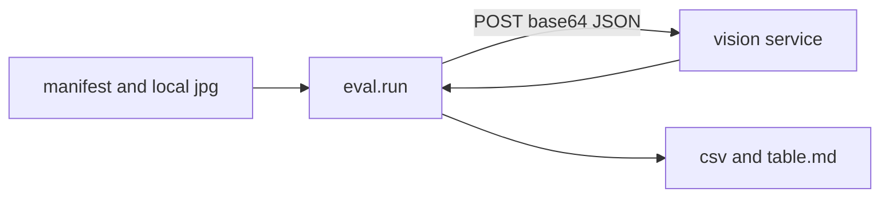

# Eval

Replays held-out frames through the vision service and writes an accuracy table for the demo.

```sh
python -m eval.run --manifest <path> --vision-url http://127.0.0.1:8001
python -m eval.run --manifest <path> --vision-url http://127.0.0.1:8001 --split all --out eval/out
```

The manifest is a JSON list. Each case has `case_id`, `split` (`train` or `heldout`), `board_id`, `image` (a path relative to the manifest), `task` (`identify`, `locate`, or `verify`), `header`, `item`, `pins`, and `truth`. The default split is `heldout`.

`truth` is `{"item"}` for identify, `{"bbox": [x, y, w, h]}` for locate, and `{"pass": bool}` for verify. A locate case with no bbox means the header is not in the frame. A locate hit needs IoU of at least 0.3, or both sides say not found.

The harness reads each image, base64-encodes it, and POSTs `/identify`, `/locate`, or `/verify`. Requests and responses are checked with `contracts.validate`. Rows record `case_id`, `task`, `header`, `expected`, `got`, `correct`, `conf`, and `ms`.

An abstention is `abstain: true`, or a locate response with `found: false` and `blur: true`. Abstentions are never correct. Accuracy for a task and header is correct answers divided by answers that were not abstentions. The abstain rate is abstentions divided by all rows in that group. `Wrong plugs caught` counts verify cases whose truth is `pass: false` and whose answer is `pass: false`, excluding abstentions.

Outputs, both gitignored:

- `eval/out/<git short sha, or local>.csv`
- `eval/out/table.md` (one row per task and header, plus the wrong-plug count)

`eval/sample/manifest.json` is three held-out cases. It points at jpeg names only. Tests write those bytes in a temp directory. Do not commit frames. Real clips stay outside the repo, for example `~/a-eye-private/clips/`.



## Brain eval

Replays `eval/brain_cases.json` (26 text-only cases, no frames; price questions are excluded because `server/shopping.py` answers them in code before the brain runs) through the real `server.agent.run_turn` on the single-brain path, the one a local model serves when there is no Anthropic key or `LOCAL_ONLY=1`. Each case's scene becomes the session's cached scene. Market searches are recorded, never sent.

```sh
python -m eval.brain_turns --model local:qwen3.5:9b-q4_K_M --model local:<small model>
python -m eval.brain_turns --model claude:claude-haiku-5-5 --tag shop
```

Per turn:

- **format**: the header line strictly matches `brain_turn` (no `say` inside it) and `SAY:` speech follows. Reported only, since the server repairs bent headers.
- **grounded**: every draw `target` and `from_target` the model wrote is a real scene id (the server silently drops invented ones)
- **target**: the server drew only on `expect.targets`; an empty list means draw nothing
- **market**: the searched category equals `expect.market`, or no search when none is expected. This includes the server's keyword rule (`shopping_category`).
- **brief**: one or two spoken sentences

A pass needs speech, grounding, the right targets and the right market. Latency is first token (what the voice waits on) and full turn. Each model gets one untimed warmup call. The production first-token timeout (`BRAIN_FIRST_TOKEN_S`, 3.5 s) still applies; a timeout shows up as provider `canned` and prints a warning.

Outputs (gitignored): `eval/out/brain.md`, plus `eval/out/brain-<model>.csv` with each turn's spoken text.
